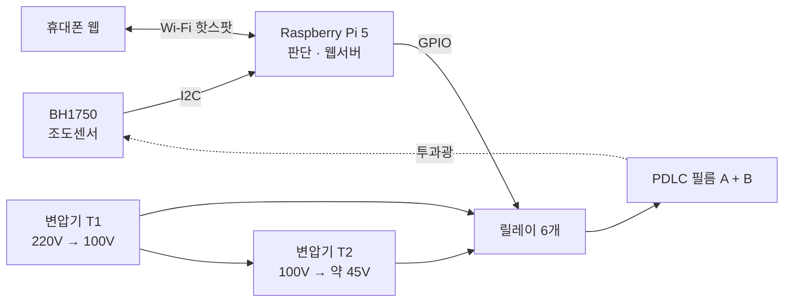
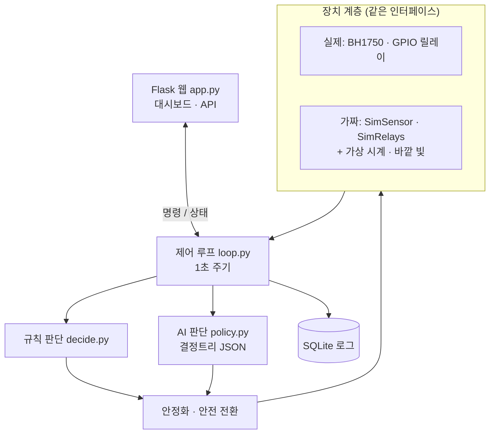
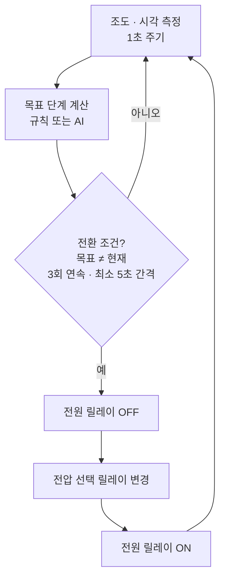
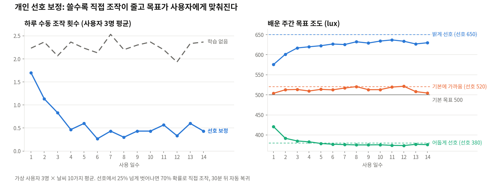
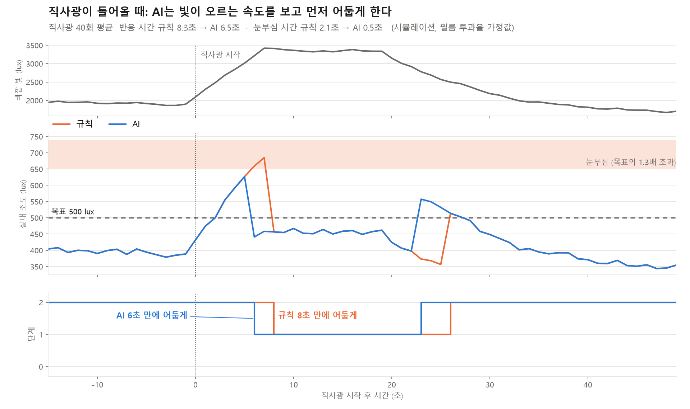
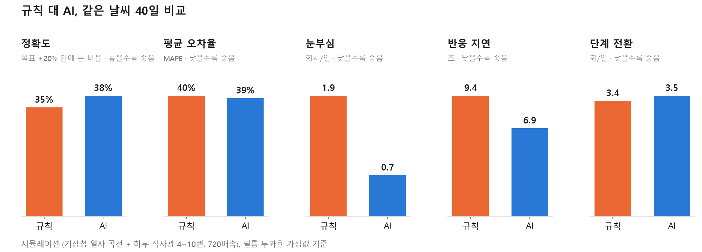

# LightQ — PDLC 6단계 AI 조광 윈도우

> 시간대마다 정한 목표 밝기에 맞춰 창문 투명도를 스스로 바꾸고, 직사광이 들어오기 전에 미리 어둡게 하는 스마트 윈도우

순천향대학교 컴퓨터공학과 캡스톤디자인(마이크로프로세서) 팀 **라이트큐**의 프로젝트입니다.
PDLC(고분자 분산 액정) 조광 필름 2장을 겹쳐 투과율을 6단계로 나누고, Raspberry Pi 5가 실내 조도와 시각을 보고 단계를 자동으로 고릅니다.

| 항목 | 내용 |
|---|---|
| 팀 | 강민재(팀장), 김대현, 곽재우 |
| 지도교수 | 양제파 |
| 연계 기업 | (주)유스바이오 |
| 기간 | 2026년 2학기 (진행 중) |

---

## 왜 만들었나

아침에 일어나기 힘든 이유 중 하나는 방이 너무 어둡거나, 반대로 갑자기 너무 밝아지기 때문입니다.
시중의 스마트 블라인드는 대부분 정해진 시각에 열고 닫거나, 밝기가 기준값을 넘으면 반응하는 방식이라 두 가지 한계가 있습니다.

- **목표 밝기를 따라가지 못합니다.** 열림과 닫힘 두 상태뿐이라 원하는 밝기에 맞춰 세밀하게 조절할 수 없습니다.
- **늦게 반응합니다.** 직사광선이 들어와 이미 눈이 부신 뒤에야 닫힙니다.

LightQ는 모터로 블라인드를 움직이는 대신 **필름의 투명도**를 바꿔서, 시간대별 목표 조도를 단계적으로 따라가고 밝기가 급하게 오를 때는 **미리** 어둡게 만듭니다.

## 주요 기능

- **6단계 투과율 제어**: 필름 2장 × (꺼짐 / 약 45V / 100V) 조합
- **시간대별 목표 조도 추종**: 기상 준비, 아침, 주간 구간마다 목표 lux를 두고 실측 조도에 맞춰 단계 선택. 저녁·취침은 차광
- **기상 모드**: 기상 20분 전부터 목표 조도를 서서히 올려 자연광처럼 밝아짐
- **AI 선제 차광**: 최근 4초의 빛 변화로 4초 뒤 빛에 맞는 단계를 미리 고름 (결정트리)
- **오프라인 웹 대시보드**: Pi 자체 Wi-Fi 핫스팟으로 인터넷 없이 휴대폰에서 실시간 조도 확인, 단계·모드·판단 방식(규칙/AI) 변경, 기상 시각 설정
- **깜빡임 방지**: 데드밴드 + 같은 방향(어둡게/밝게) 판단 3회 연속 + 마지막 전환 후 5초 경과일 때만 전환
- **안전 장치**: 전압 전환 때 항상 전원 먼저 차단, 센서가 연속 10회 응답하지 않으면 모든 필름 전원 차단
- **하루 압축 재생**: 가상 시계로 하루를 2분에 재생해 시연
- **개인 선호 보정**: 사용자가 웹에서 직접 단계를 바꾸면 그 밝기를 선호로 배워 사용자별 목표 조도를 보정 (프로필별 저장)

## 시스템 구성



### 필름 구동 원리

PDLC 필름은 교류 전압을 걸면 투명해지고, 전압이 없으면 빛을 흩뜨려 불투명해집니다.
상용 디밍 컨트롤러 대신 가정용 강압 변압기 2대로 두 가지 전압을 만들고, 릴레이로 필름마다 전압을 고릅니다.

- **T1**: 220V를 100V로 낮춥니다. 필름을 완전히 켜는 전압입니다.
- **T2**: T1의 100V 출력을 다시 낮춰 약 45V를 만듭니다. 필름을 반쯤 켜는 전압입니다.
- 두 변압기 출력은 서로 다른 회로라서, 필름마다 **두 선을 함께 전환**하는 선택 릴레이 2개와 전원 릴레이 1개를 씁니다.

| 단계 | 필름 A | 필름 B | 상태 |
|:-:|:-:|:-:|---|
| 0 | 꺼짐 | 꺼짐 | 가장 어두움 (취침·저녁) |
| 1 | 45V | 꺼짐 | |
| 2 | 45V | 45V | |
| 3 | 100V | 꺼짐 | |
| 4 | 100V | 45V | |
| 5 | 100V | 100V | 가장 밝음 |

> 2단계와 3단계의 실제 밝기 순서는 실측으로 확정합니다. 실측값(`pi/data/lut.json`)을 넣으면 프로그램이 단계 순서를 밝기 순으로 자동 정렬합니다.

## 소프트웨어 구조



- 센서·릴레이의 함수 모양을 먼저 정해, 노트북에서는 가짜 장치로, Pi에서는 실제 장치로 **같은 제어 코드**를 돌립니다.
- 웹은 명령만 보내고 릴레이는 제어 루프 한 곳에서만 움직입니다 (스레드 간 lock).
- 규칙과 AI는 같은 모양의 판단 함수라 웹에서 바로 바꿔 끼울 수 있습니다.

## 제어 흐름



전압을 바꿀 때는 항상 **전원 끄기 → 전압 선택 → 전원 켜기** 순서를 지킵니다. 필름에 전압이 걸린 상태로 전압 단자가 바뀌지 않게 하기 위해서입니다. 이 순서는 가능한 36가지 단계 전환 모두 자동 테스트로 검증합니다.

### 규칙 판단

1. 입사광 추정: `실측 조도 / 현재 단계 투과율` (센서가 필름 안쪽에 있어 바깥 빛을 역산)
2. 필요 투과율: `목표 조도 / 입사광`
3. 필요 투과율에 가장 가까운 단계를 고르고, 현재 단계와 차이가 작으면(데드밴드 0.05) 유지

## AI 선제 차광

규칙 판단은 **지금** 빛만 보기 때문에 직사광이 다 올라온 뒤에야 반응합니다. AI는 빛이 오르는 속도를 보고 **4초 뒤 빛**에 맞는 단계를 미리 고릅니다.

| 항목 | 내용 |
|---|---|
| 입력 특징 (6개) | 필요 투과율(log), 최근 3구간 입사광 변화율, 현재 단계, 목표 조도 |
| 정답 | 시뮬레이터가 아는 4초 뒤 실제 입사광에 맞는 단계 |
| 학습 데이터 | 300일, 약 5.5만 행. 기상청 ASOS 일사량 곡선(서산·홍성·보령) + 합성 구름·직사광, 배속·기상 시각 무작위 |
| 모델 | 결정트리 (깊이 8, 잎 186개) |
| 검증 | 날짜 단위로 5일 중 1일을 떼어 처음 보는 날로 시험 |
| 실행 | 학습은 노트북(scikit-learn), Pi는 트리 구조 JSON(약 9KB)만 읽어 if문으로 추론 |

| 모델 시험 (정답 = 4초 뒤 빛 기준) | 규칙 | AI |
|---|---|---|
| 전체 | 77.5% | 85.0% |
| 빛이 오르는 구간 | 50.1% | 71.0% |

일사량 환산은 `tools/convert_kma_radiation.py`를 따릅니다. 기상청 일사량(1시간 누적, MJ/m²)을 평균 일사강도(W/m²)로 바꾸고 자연광 발광효율 약 116 lm/W를 곱합니다. 학습에는 곡선의 모양만 쓰고, 크기는 시연 조명 수준으로 맞춥니다.

## 개인 선호 보정

AI(결정트리)는 **목표에 어떻게 빨리 맞출지**를 정하는 공통 모델이고, 선호 보정은 **목표를 얼마로 할지**를 사람마다 맞춥니다.

| 항목 | 내용 |
|---|---|
| 학습 신호 | 사용자가 단계를 직접 바꾼 뒤 3초 동안 잰 실내 조도(중앙값) = 그 사람이 원하는 밝기 |
| 학습 방식 | 시간대(아침·주간)별 보정값 ← 0.7 × 보정값 + 0.3 × (선호 조도 / 기본 목표 − 1), ±30% 제한 |
| 사용자 | 웹에서 프로필 선택·추가, `pi/data/preferences.json`에 저장 (재부팅해도 유지) |
| 사전 학습 | 필요 없음. 사용하면서 배우는 온라인 학습 |

선호가 다른 가상 사용자 3명(주간 선호 650 / 520 / 380 lux)을 날씨 10가지로 2주씩 돌려 검증했습니다 (`python -m pi.ai.eval_preference`).



| 지표 (마지막 7일 평균) | 학습 없음 | 선호 보정 |
|---|---|---|
| 하루 수동 조작 횟수 (3명 평균) | 2.24회 | **0.44회** |
| 배운 주간 목표 (밝게 / 기본 근처 / 어둡게 선호) | 500 / 500 / 500 | **630 / 504 / 376** |

- 선호가 기본값과 비슷한 사용자는 원래 조작이 적어 차이가 거의 없습니다 (0.36 → 0.49회, 오차 범위).
- 가상 사용자 행동(25% 넘게 벗어나면 70% 확률로 조작)은 가정입니다.

## 정량 평가

같은 날씨·같은 센서 잡음으로 규칙과 AI를 각각 돌려 비교합니다. 그래프는 `python -m pi.ai.plot_compare`로 다시 만들 수 있습니다.

### 직사광 한 번 (실제 시간 1배속, 40회 평균)



| 지표 | 규칙 | AI |
|---|---|---|
| 직사광 시작부터 어둡게 바꿀 때까지 | 5.2초 | **3.0초** |
| 눈부심 시간 (목표의 1.3배 초과) | 6.2초 | **0.7초** |

### 하루 단위 (학습에 쓰지 않은 40일, 하루 직사광 4~10번, 720배속)



| 지표 | 정의 | 규칙 | AI |
|---|---|---|---|
| 정확도 | 실내 조도가 목표 ±20% 안에 든 비율 | 39.7% | **52.5%** |
| MAPE | 목표 대비 평균 절대 오차율 | 35.0% | **27.9%** |
| 눈부심 | 목표의 1.3배를 넘은 회차/일 | 6.2 | **3.4** |
| 전환 횟수 | 단계가 바뀐 횟수/일 | 7.1 | **6.6** |
| 반응 지연 | 직사광 시작부터 어둡게 바꿀 때까지 | 4.7초 | **4.0초** |

- AI는 눈부심을 절반 가까이 줄이면서 단계 전환은 오히려 줄었습니다.
- 720배속에서는 1회(1초)가 가상 12분이라 하루 곡선 자체의 변화가 커서, 직사광만 따로 본 1배속보다 차이가 작게 나옵니다.
- 정확도가 둘 다 낮은 이유는 아침·해 질 녘처럼 5단계로 다 열어도 목표에 못 미치는 시간이 포함되기 때문입니다.
- 현재 결과는 필름 투과율 가정값 기준입니다. 단계별 실측 후 다시 학습·평가합니다.
- 로그는 `tools/metrics.py`가 읽는 형식(`ms, hour, lux, level`)으로도 내보냅니다.

## 실행 방법

레포 최상위 폴더에서 실행합니다. (Python 3.11)

```bash
pip install -r pi/requirements.txt            # flask, pytest (Pi에서는 센서·GPIO 라이브러리 포함)

python -m pi.app --speed 720 --start 06:30    # 노트북: 가짜 장치로 하루를 2분에 재생
python -m pi.app --real                       # Pi 5: 실제 센서·릴레이
python -m pi.app --real --start 11:00 --speed 0   # 실물 시연: 시각을 주간에 고정
```

브라우저에서 `http://localhost:5000` (Pi 핫스팟에서는 Pi 주소의 5000번 포트)

```bash
python -m pytest pi/tests -q                  # 자동 테스트 30개 (+ 실제 드라이버 테스트 5개, 드라이버가 생기면 자동 실행)

pip install -r pi/requirements-ai.txt         # AI 학습용 (노트북에서만)
python -m pi.ai.retrain                       # 데이터 생성 → 학습 → 규칙 대 AI 비교
python -m pi.ai.plot_compare                  # 비교 그래프 (docs/images)
python -m pi.ai.eval_preference               # 개인 선호 보정 검증 (가상 사용자 3명)
```

### Raspberry Pi 5 설치

Pi를 받은 날의 OS 설치부터 센서·릴레이 시험, 핫스팟, 부팅 시 자동 실행까지 순서는 [deploy/README.md](deploy/README.md)에 있습니다.

```bash
bash deploy/setup_pi.sh                            # 패키지·I2C·가상환경·테스트
.venv/bin/python -m pi.tools.check_sensor          # 조도센서 확인
.venv/bin/python -m pi.tools.check_relays --each   # 릴레이 확인 (교류 연결 없이)
```

### 실측값 반영

필름 조립 후 같은 광원에서 0~5단계 실내 조도와 광원을 끈 잡광을 잰 뒤:

```bash
python -m pi.calib --lux 182 279 410 475 715 1273 --ambient 5   # pi/data/lut.json 생성
python -m pi.ai.retrain                                         # 실측 기준으로 AI 다시 학습
```

값 순서는 기본 단계표(꺼짐/꺼짐, 45V/꺼짐, 45V/45V, 100V/꺼짐, 100V/45V, 100V/100V)입니다. 단계 순서 정렬, 판단 규칙, 시뮬레이터, AI 학습이 모두 실측값으로 바뀝니다. 투과율표가 바뀌었는데 재학습하지 않으면 웹에 경고가 뜹니다.

## 기술 스택

- **하드웨어**: Raspberry Pi 5, BH1750(GY-302), 1채널 릴레이 모듈 6개, 가정용 강압 변압기 2대, PDLC 조광 필름 2장
- **소프트웨어**: Python, Flask, SQLite, gpiozero · lgpio, smbus2, NumPy, scikit-learn · matplotlib(노트북 학습·그래프만), pytest
- **프런트엔드**: HTML · CSS · JavaScript, 외부 라이브러리 없이 SVG 그래프 (핫스팟에 인터넷이 없으므로)
- **네트워크**: NetworkManager 핫스팟 (외부 인터넷 불필요)

## 폴더 구조

```
.
├── pi/                 # Raspberry Pi 5 실행 코드
│   ├── app.py          # Flask 웹 서버와 API
│   ├── config.py       # 모든 설정값 (GPIO 번호, 단계표, 목표 조도, 안전)
│   ├── calib.py        # 단계별 실측값(lut.json) 읽기·쓰기
│   ├── storage.py      # SQLite 로그, CSV 내보내기
│   ├── control/        # 규칙 판단, 제어 루프, 단계 전환·안정화, 개인 선호 보정
│   ├── devices/        # 장치 인터페이스, 가짜 센서·릴레이 (실제 드라이버 작성 중)
│   ├── sim/            # 가상 시계, 바깥 빛 시뮬레이션
│   ├── ai/             # 학습 데이터, 결정트리 학습·추론, 규칙 대 AI 평가
│   ├── templates/, static/   # 대시보드 화면
│   ├── data/           # 학습된 모델(ai_tree.json), 실측값(lut.json)
│   ├── tests/          # pytest
│   └── tools/          # 센서·릴레이 확인 도구
├── deploy/             # Pi 설치 스크립트, 핫스팟, 자동 실행(systemd), 설치 안내서
├── tools/              # 기상청 일사량 → 조도 변환, 정량지표 계산
├── data/               # 기상청 ASOS 일사량 원본
├── hardware/           # 부품 목록, Pi 5 배선, 안전 점검표
├── docs/               # 정량지표 정의, 비교 그래프(images/)
├── server/ai/          # 초기 Arduino용 모델 학습 코드 (참고용)
└── firmware/           # 초기 Arduino Uno 프로토타입 (참고용)
```

## 진행 상황

- [x] 필름 2장 겹침 6단계 구조와 변압기·릴레이 구동 방식 확정
- [x] 기상청 일사량 → 조도 변환 도구, 정량지표 계산 스크립트
- [x] 장치 인터페이스와 가짜 장치, 가상 시계 시뮬레이터
- [x] 규칙 판단, 제어 루프, 안정화, 안전 전환 순서
- [x] 오프라인 웹 대시보드와 하루 압축 재생, SQLite 로그
- [x] AI 선제 차광 (결정트리), 규칙 대 AI 비교 (시뮬레이션)
- [x] 실측값 자동 반영 구조, 센서 고장 대비, 자동 테스트 23개, 비교 그래프
- [ ] Pi 5 센서 · 릴레이 드라이버
- [ ] 3단계 동작 → 6단계 확장, 단계별 조도 실측
- [ ] 실측 기준 재학습·재평가, Pi 핫스팟 배포
- [x] 개인 선호 보정 (사용자 프로필, 가상 사용자 검증)
- [ ] 최종 시연

## 설계하면서 내린 결정

- **트라이악 디머를 쓰지 않았습니다.** 위상 제어는 사인파를 잘라 내는 방식이라 PDLC 같은 용량성 부하에 맞지 않고, 필름 제조사도 권장하지 않았습니다. 정상 사인파를 그대로 쓰는 변압기 방식을 택했습니다.
- **상용 디밍 컨트롤러 대신 직접 구동했습니다.** 납기 문제로 상용 컨트롤러를 쓸 수 없게 되어, 필름 2장 겹침과 2단 변압기로 단계를 직접 설계했습니다. 단계 선택과 판단 로직이 모두 우리 소프트웨어 안에 있게 되었습니다.
- **필름을 겹쳐 단계를 늘렸습니다.** 한 장으로는 켜고 끄는 두 상태뿐이지만, 두 장을 겹치고 전압을 두 가지로 쓰면 6가지 조합이 나옵니다. 대신 가장 밝은 상태의 투명도는 한 장일 때보다 조금 낮아집니다.
- **메인 보드를 Raspberry Pi 5로 바꿨습니다.** 처음에는 Arduino Uno에서 모델을 C 코드로 돌릴 계획이었지만, 웹 대시보드와 학습·로그 기능까지 한 장치에서 처리하기 위해 Pi 5로 통일했습니다.
- **AI 모델로 결정트리를 골랐습니다.** 특징 6개짜리 작은 문제라 충분하고, 판단 근거를 설명할 수 있으며, Pi에서 무거운 라이브러리 없이 1ms 안에 추론됩니다.
- **안정화 조건을 '같은 값'에서 '같은 방향'으로 바꿨습니다.** AI는 직사광이 오를 때 후보가 2 → 1 → 2처럼 어둡게 가는 방향은 같지만 값이 흔들려, '같은 값 3회 연속' 조건에서는 오히려 늦게 반응했습니다. 비교 실험에서 발견해 고쳤습니다.
- **하드웨어 전에 시뮬레이터부터 만들었습니다.** 부품 도착 전에도 판단·웹·AI를 개발하고, 같은 조건에서 규칙과 AI를 공정하게 비교하기 위해서입니다.

## 안전

필름 구동부는 교류 100V가 흐르므로 다음을 지킵니다.

- 릴레이 접점과 연결부는 모두 절연 케이스 안에 두고 뚜껑을 닫은 뒤 전원을 넣습니다.
- 필름 연결 전 테스터로 변압기 출력 전압을 확인합니다 (필름 정격 60~110V).
- 배선을 바꿀 때는 변압기 플러그를 뽑습니다.
- 소프트웨어: 전압 전환 때 전원 먼저 차단, 시작·종료 시 모든 릴레이 꺼짐, 센서 연속 10회 실패 시 0단계(전원 차단).

자세한 점검 항목은 `hardware/safety_checklist.md`에 있습니다.

## 협업 방식

- `main`은 항상 동작하는 상태로 유지하고, 기능은 `feature/기능명` 브랜치에서 작업한 뒤 PR로 병합합니다.
- 커밋 메시지는 `[파트] 내용` 형식을 씁니다. 예: `[pi] 릴레이 전환 순서 고정`
- PR 전에 `python -m pytest pi/tests -q`가 통과해야 합니다.
