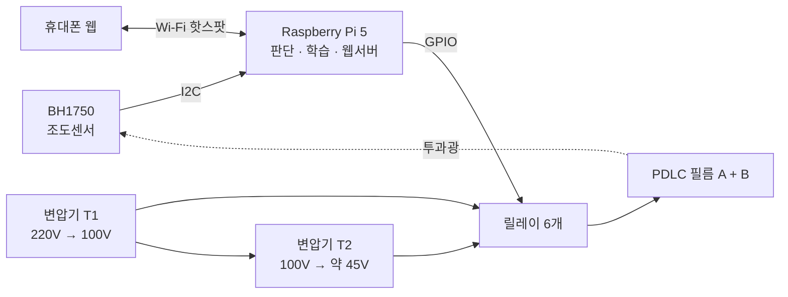
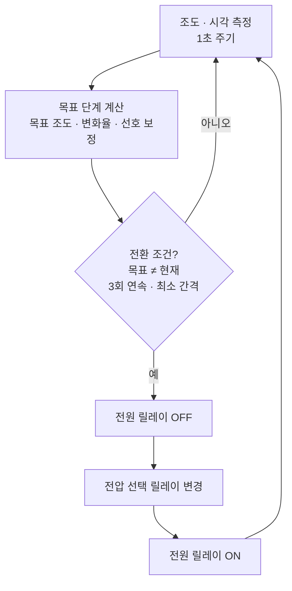

# LightQ — PDLC 6단계 AI 조광 윈도우

> 시간대마다 정한 목표 밝기에 맞춰 창문 투명도를 스스로 바꾸는 스마트 윈도우

순천향대학교 컴퓨터공학과 캡스톤디자인(마이크로프로세서) 팀 **라이트큐**의 프로젝트입니다.
PDLC(고분자 분산 액정) 조광 필름 2장을 겹쳐 투과율을 6단계로 나누고, Raspberry Pi 5가 실내 조도와 시각을 보고 단계를 자동으로 고릅니다.

| 항목 | 내용 |
|---|---|
| 팀 | 강민재(팀장), 김대현, 곽재우 |
| 지도교수 | 양제파 |
| 연계 기업 | (주)유스바이오 |
| 기간 | 2026년 2학기 (진행 중) |

---

## 왜 만들었나

아침에 일어나기 힘든 이유 중 하나는 방이 너무 어둡거나, 반대로 갑자기 너무 밝아지기 때문입니다.
시중의 스마트 블라인드는 대부분 정해진 시각에 열고 닫거나, 밝기가 기준값을 넘으면 반응하는 방식이라 두 가지 한계가 있습니다.

- **목표 밝기를 따라가지 못합니다.** 열림과 닫힘 두 상태뿐이라 원하는 밝기에 맞춰 세밀하게 조절할 수 없습니다.
- **늦게 반응합니다.** 직사광선이 들어와 이미 눈이 부신 뒤에야 닫힙니다.

LightQ는 모터로 블라인드를 움직이는 대신 **필름의 투명도**를 바꿔서, 시간대별 목표 조도를 단계적으로 따라가고 밝기가 급하게 오를 때는 **미리** 어둡게 만듭니다.

## 주요 기능

- **6단계 투과율 제어**: 필름 2장 × (꺼짐 / 약 45V / 100V) 조합
- **시간대별 목표 조도 추종**: 취침, 기상, 주간, 일몰 후 구간마다 목표 lux를 두고 실측 조도에 맞춰 단계 선택
- **기상 모드**: 기상 20분 전부터 단계를 서서히 올려 자연광처럼 밝아짐
- **선제 차광**: 조도 변화 속도(dLux/dt)로 급격한 밝기 상승을 감지해 한 단계 먼저 차광
- **개인 선호 학습**: 사용자가 웹에서 직접 바꾼 단계를 불만족 신호로 보고 선호 조도를 보정
- **오프라인 웹 대시보드**: Pi 자체 Wi-Fi 핫스팟으로 인터넷 없이 휴대폰에서 실시간 조도 확인, 단계 변경, 기상 시간 설정
- **깜빡임 방지**: 같은 판단이 3회 연속일 때만, 마지막 전환 후 최소 간격이 지났을 때만 단계 전환

## 시스템 구성



### 필름 구동 원리

PDLC 필름은 교류 전압을 걸면 투명해지고, 전압이 없으면 빛을 흩뜨려 불투명해집니다.
상용 디밍 컨트롤러 대신 가정용 강압 변압기 2대로 두 가지 전압을 만들고, 릴레이로 필름마다 전압을 고릅니다.

- **T1**: 220V를 100V로 낮춥니다. 필름을 완전히 켜는 전압입니다.
- **T2**: T1의 100V 출력을 다시 낮춰 약 45V를 만듭니다. 필름을 반쯤 켜는 전압입니다.
- 두 변압기 출력은 서로 다른 회로라서, 필름마다 **두 선을 함께 전환**하는 선택 릴레이 2개와 전원 릴레이 1개를 씁니다.

| 단계 | 필름 A | 필름 B | 상태 |
|:-:|:-:|:-:|---|
| 0 | 꺼짐 | 꺼짐 | 가장 어두움 (취침) |
| 1 | 45V | 꺼짐 | |
| 2 | 45V | 45V | |
| 3 | 100V | 꺼짐 | |
| 4 | 100V | 45V | |
| 5 | 100V | 100V | 가장 밝음 (주간) |

> 2단계와 3단계의 실제 밝기 순서와 단계별 조도는 실측으로 확정합니다. 단계 수는 설정값이라 하드웨어가 바뀌어도 코드 수정 없이 맞출 수 있습니다.

## 제어 흐름



전압을 바꿀 때는 항상 **전원 끄기 → 전압 선택 → 전원 켜기** 순서를 지킵니다. 필름에 걸린 상태로 전압 단자가 바뀌지 않게 하기 위해서입니다.

## AI 판단

| 항목 | 내용 |
|---|---|
| 입력 특징 | 현재 조도, 직전 조도, 조도 변화율, 시각, 현재 단계 |
| 학습 데이터 | 기상청 ASOS 시간별 일사량을 조도(lux)로 환산한 실제 일사 패턴 + 하루 단위 합성 시계열 (구름·직사광 급변 시뮬레이션) |
| 모델 | 경량 결정트리 계열 (Pi 5에서 실시간 추론) |
| 개인화 | 수동 조작 기록으로 시간대별 목표 조도 오프셋 보정 |
| 비교 기준 | 규칙 기반 제어 대 AI 제어 — 목표 조도 편차, 단계 전환 횟수 |

실내 실측 데이터를 충분히 모을 시간이 부족해, 지도교수님 방향에 따라 실제 기상 관측값과 합성 데이터를 함께 써서 학습하고 필름 단계별 실측 조도로 보정합니다.

일사량 환산은 `tools/convert_kma_radiation.py`가 맡습니다. 기상청 일사량(1시간 누적, MJ/m²)을 평균 일사강도(W/m²)로 바꾼 뒤, 자연광 발광효율 약 116 lm/W를 곱해 조도로 환산합니다.

## 정량 평가

`tools/metrics.py`로 로그(`ms, hour, lux, level`)를 분석합니다.

| 지표 | 정의 |
|---|---|
| 정확도 | 실내 조도가 그 시간대 목표 조도 ±허용오차 안에 든 비율, 평균 절대 오차율(MAPE) |
| 오탐률 | 이미 목표를 만족하는 안정 상태에서 불필요하게 단계를 바꾼 비율 |
| 지연시간 | 조도 급변 감지부터 단계 전환 완료까지 걸린 시간 |

## 기술 스택

- **하드웨어**: Raspberry Pi 5, BH1750(GY-302), 1채널 릴레이 모듈 6개, 가정용 강압 변압기 2대, PDLC 조광 필름 2장
- **소프트웨어**: Python, gpiozero · lgpio, smbus2, Flask, SQLite, NumPy, pandas, scikit-learn
- **네트워크**: NetworkManager 핫스팟 (외부 인터넷 불필요)

## 폴더 구조

```
.
├── pi/            # Raspberry Pi 5 실행 코드 (센서, 릴레이, 판단, 웹) — 작성 중
├── server/ai/     # 합성 시계열 데이터 생성, 모델 학습
├── tools/         # 기상청 일사량 → 조도 변환, 로그 수집, LUT 생성, 정량지표 계산
├── hardware/      # 배선도, 안전 점검표, 시험 스케치
├── data/          # 기상청 ASOS 일사량 원본, 변환된 샘플 로그
├── docs/          # 설계 문서, 정량지표 정의
└── firmware/      # 초기 Arduino Uno 프로토타입 (참고용)
```

## 진행 상황

- [x] 필름 2장 겹침 6단계 구조와 변압기·릴레이 구동 방식 확정
- [x] 판단 로직 PC 시뮬레이션과 호스트 테스트
- [x] 기상청 일사량 → 조도 변환 도구, 정량지표 계산 스크립트
- [ ] Pi 5 센서 · 릴레이 드라이버
- [ ] 3단계 동작 → 6단계 확장, 단계별 조도 실측
- [ ] 자동 추종 · 선제 차광 · 개인 선호 보정
- [ ] 웹 대시보드와 하루 압축 재생 시연 모드
- [ ] 규칙 대 AI 정량 비교, 최종 시연

## 설계하면서 내린 결정

- **트라이악 디머를 쓰지 않았습니다.** 위상 제어는 사인파를 잘라 내는 방식이라 PDLC 같은 용량성 부하에 맞지 않고, 필름 제조사도 권장하지 않았습니다. 정상 사인파를 그대로 쓰는 변압기 방식을 택했습니다.
- **상용 디밍 컨트롤러 대신 직접 구동했습니다.** 납기 문제로 상용 컨트롤러를 쓸 수 없게 되어, 필름 2장 겹침과 2단 변압기로 단계를 직접 설계했습니다. 단계 선택과 판단 로직이 모두 우리 소프트웨어 안에 있게 되었습니다.
- **필름을 겹쳐 단계를 늘렸습니다.** 한 장으로는 켜고 끄는 두 상태뿐이지만, 두 장을 겹치고 전압을 두 가지로 쓰면 6가지 조합이 나옵니다. 대신 가장 밝은 상태의 투명도는 한 장일 때보다 조금 낮아집니다.
- **메인 보드를 Raspberry Pi 5로 바꿨습니다.** 처음에는 Arduino Uno에서 모델을 C 코드로 돌릴 계획이었지만, 웹 대시보드와 학습·로그 기능까지 한 장치에서 처리하기 위해 Pi 5로 통일했습니다.

## 안전

필름 구동부는 교류 100V가 흐르므로 다음을 지킵니다.

- 릴레이 접점과 연결부는 모두 절연 케이스 안에 두고 뚜껑을 닫은 뒤 전원을 넣습니다.
- 필름 연결 전 테스터로 변압기 출력 전압을 확인합니다 (필름 정격 60~110V).
- 배선을 바꿀 때는 변압기 플러그를 뽑습니다.

자세한 점검 항목은 `hardware/safety_checklist.md`에 있습니다.

## 협업 방식

- `main`은 항상 동작하는 상태로 유지하고, 기능은 `feature/기능명` 브랜치에서 작업한 뒤 PR로 병합합니다.
- 커밋 메시지는 `[파트] 내용` 형식을 씁니다. 예: `[pi] 릴레이 전환 순서 고정`
