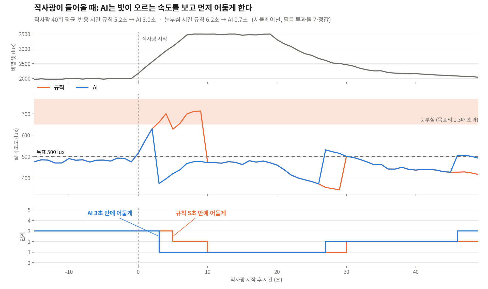
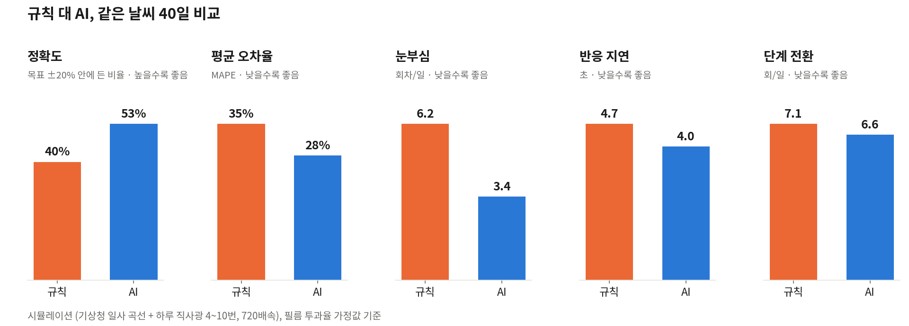

# 트러블슈팅: 6단계(100V)에서 3단계(45V)로

| 항목 | 내용 |
|---|---|
| 시기 | 2026-10-29, 하드웨어 조립 중 |
| 문제 | 필름 구동 전압(업체 안내 AC 60~70V)보다 높은 100V를 쓰는 설계. 변압기가 단권이라 꺼진 필름에도 전압이 남는 구조 |
| 결정 | 100V를 빼고 45V만 쓰는 3단계, 남는 릴레이로 필름 두 선을 모두 차단 |
| 남겨 둔 것 | 6단계 설계, 6단계 AI 모델(`pi/data/ai_tree_6level.json`), 6단계 비교 그래프(`docs/archive/six-level/`), 설정 하나로 6단계 복귀(`LIGHTQ_LEVELS=6`) |

## 1. 원래 계획 (6단계)

상용 디밍 컨트롤러를 납기 문제로 쓸 수 없게 되어, 가정용 강압 변압기 2대로 두 가지 전압을 만들었습니다.

- T1: 220V → 100V (필름을 완전히 켜는 전압으로 가정)
- T2: T1 출력에 꽂아 100V → 약 45V (필름을 반쯤 켜는 전압으로 가정)
- 필름 2장 × (꺼짐 / 45V / 100V)를 조합해 6단계

| 단계 | 필름 A | 필름 B |
|:-:|:-:|:-:|
| 0 | 꺼짐 | 꺼짐 |
| 1 | 45V | 꺼짐 |
| 2 | 45V | 45V |
| 3 | 100V | 꺼짐 |
| 4 | 100V | 45V |
| 5 | 100V | 100V |

릴레이 6개 구성:

| 신호 | GPIO | 릴레이 | 역할 |
|---|---|---|---|
| SA | 17 | SA1, SA2 | 필름 A 전압 선택 (NC = 45V, NO = 100V). 두 변압기 출력이 다른 회로라 두 선을 함께 전환 |
| PA | 27 | PA | 필름 A 전원 (선 1만 차단) |
| SB | 22 | SB1, SB2 | 필름 B 전압 선택 |
| PB | 23 | PB | 필름 B 전원 (선 1만 차단) |

전환 순서는 항상 P 끄기 → S 바꾸기 → P 켜기였습니다(`pi/control/levels.py`). 2·3단계의 밝기 순서는 실측값으로 자동 정렬하도록 만들었습니다(`pi/calib.py`).

## 2. 문제 발견

1. **변압기가 단권(입출력 비절연)이었습니다.** 멀티미터 저항 모드로 입력 플러그 핀과 출력 콘센트 구멍 사이가 이어진 것을 확인했습니다. 변압기 뒤 모든 선이 220V 콘센트와 전기적으로 이어져 있어, 선 한 가닥만 만져도 감전될 수 있습니다.
2. **6단계 회로는 필름의 선 2가 전원 릴레이를 거치지 않았습니다.** 0단계(전원 릴레이 꺼짐)여도 T1 플러그가 꽂혀 있으면 필름 한쪽 전극에 전압이 남습니다. 단권 변압기와 겹치면 위험이 커집니다. 릴레이를 2개 더 달아 해결하려면 8개가 필요했지만 보유한 것은 7개였습니다.
3. **필름 업체가 구동 전압을 AC 60~70V로 안내했습니다** ("220V를 60~70V로 다운트랜스하여 사용"). 100V는 정격을 넘어 절연 파괴, 얼룩, 수명 단축 위험이 있었고, 필름은 주문 제작이라 학술제 전에 대체할 수 없었습니다.

## 3. 검토한 대안

| 대안 | 판단 |
|---|---|
| 220V → 60~70V 변압기 추가 구매 | 가장 바른 방법. 구매 승인과 배송 시간이 학술제 일정에 맞지 않음 |
| 실습실 슬라이닥스(가변 변압기) 대여 | 구하면 6단계 복귀 가능(부록 경로). 확보 여부 불확실 |
| 저항이나 콘덴서를 직렬로 달아 전압 낮추기 | 필름이 용량성 부하라 나뉘는 전압이 필름 정전용량과 상태에 따라 변함. 불안정 |
| 필름 2장을 직렬로 연결해 50V씩 나누기 | 두 장이 항상 같이 켜져서 단계를 나눌 수 없음 |
| 단권 변압기 탭 사이 전압 차이(약 55V) 이용 | 콘센트 핀 방향에 따라 결과가 바뀌고 잘못 연결하면 100V나 단락. 위험 |
| 100V를 시연 때만 짧게 사용 | 6단계는 유지되지만 필름 손상 위험을 감수해야 함 |
| **45V만 쓰는 3단계** | 정격 안, 추가 구매 없음. 단계 수는 줄어듦 → **채택** |

참고: 병렬 연결은 모든 부품에 같은 전압이 걸려서 전압을 낮추는 방법이 아닙니다.

## 4. 결정: 45V 3단계 + 두 선 차단

| 단계 | 필름 A | 필름 B | 켜지는 릴레이 |
|:-:|:-:|:-:|---|
| 0 | 꺼짐 | 꺼짐 | 없음 |
| 1 | 45V | 꺼짐 | PA, PA2 |
| 2 | 45V | 45V | PA, PA2, PB, PB2 |

- 전압 선택 릴레이(SA, SB)가 필요 없어진 자리에 전원 릴레이를 하나씩 더 달았습니다. PA·PA2는 GPIO27, PB·PB2는 GPIO23을 함께 씁니다.
- 꺼진 필름은 두 전극이 모두 전원에서 분리됩니다. 2번 문제(선 2 미차단)가 같이 해결됐습니다.
- 릴레이 7개 중 4개만 써서 추가 구매가 없습니다. T1은 T2에 전기를 주는 용도로만 남았습니다.
- 대가: 단계가 6개에서 3개로 줄고, 가장 밝은 상태가 어두워집니다(시뮬레이션 가정 투과율 0.64 → 0.2025).

## 5. 코드: 설정 하나로 두 구성을 모두 지원

| 파일 | 변경 |
|---|---|
| `pi/calib.py` | `LEVELS_3`, `LEVELS_6`, `LEVEL_MODE`(환경변수 `LIGHTQ_LEVELS`, 기본 3) |
| `pi/config.py` | 단계표, 기본 투과율, AI 모델 경로(`AI_MODEL_PATH`)가 모드를 따름 |
| `pi/devices/sim.py` | 가장 밝은 단계의 절대 투과율을 단계표에서 계산 |
| `pi/tools/calibrate.py`, `check_relays.py` | 단계 수와 안내 문구가 모드를 따름 |
| `pi/ai/policy.py` | 모델이 내는 단계를 현재 단계 수 안으로 묶음(재학습 전 안전장치) |
| `pi/data/ai_tree.json` | 3단계로 다시 학습 |
| `pi/data/ai_tree_6level.json` | 6단계 때 학습한 모델 보관 |

6단계로 돌아가려면:

1. 60~70V 전원(슬라이닥스나 전용 변압기)을 구해 전원선 A를 거기에 꽂고, 위 1장의 릴레이 6개 배선으로 바꿉니다.
2. 실행할 때 `LIGHTQ_LEVELS=6`을 붙입니다. 자동 실행이면 systemd 파일에 `Environment=LIGHTQ_LEVELS=6`.
3. AI는 보관한 6단계 모델을 바로 씁니다. 실측 후에는 값 6개로 `pi.calib` → `pi.ai.retrain`.

테스트는 두 모드 모두 통과합니다(`pytest`, `LIGHTQ_LEVELS=6 pytest`, 각 57개).

## 6. 6단계 시뮬레이션 결과 (보관)

같은 평가 도구(`python -m pi.ai.evaluate --days 40`, 배속 720, 직사광 하루 4~10번)로 잰 값입니다.

| 지표 | 6단계 규칙 | 6단계 AI | 3단계 규칙 | 3단계 AI |
|---|---|---|---|---|
| 정확도(목표 ±20%) | 39.7% | 52.5% | 34.6% | 38.3% |
| MAPE | 35.0% | 27.9% | 39.9% | 39.1% |
| 눈부심 회차/일 | 6.2 | 3.4 | 1.9 | 0.7 |
| 전환 횟수/일 | 7.1 | 6.6 | 3.4 | 3.5 |
| 반응 지연(초) | 4.72 | 4.04 | 9.38 | 6.86 |

- 두 구성 모두 AI가 규칙보다 정확도, 눈부심, 반응 지연에서 낫습니다.
- 3단계는 가장 밝은 상태가 어두워서 시뮬레이션의 목표 조도(주간 500 lux)에 자주 못 미칩니다. 그래서 정확도가 낮고 눈부심이 적습니다. 두 구성의 숫자를 그대로 비교하면 안 되고, 실측 후 목표 조도를 실제 밝기 범위에 맞추면 바뀝니다.
- 3단계에서 반응 지연이 길게 나온 것은 단계 사이 간격이 넓어 한 번 바꿀 때 밝기 변화가 크기 때문으로 보입니다(추정, 실측으로 확인 필요).

6단계 때 만든 비교 그래프:

`docs/images/`의 그래프는 3단계 실측 후 `python -m pi.ai.plot_compare`로 다시 만듭니다.

## 7. 배운 점

- **부품 정격은 설계 전에 확인합니다.** 필름 구동 전압을 "60~110V"로 넓게 가정하고 회로를 짰는데, 실제 안내는 60~70V였습니다. 주문할 때 사양서를 받아 두었어야 했습니다.
- **변압기는 단권인지 복권인지 먼저 잽니다.** 가정용 다운변압기는 대부분 단권이라, 출력 쪽도 220V로 다뤄야 합니다.
- **바뀔 수 있는 결정은 설정으로 분리합니다.** 단계 구성을 코드 곳곳에 박지 않고 한 곳(`LIGHTQ_LEVELS`)으로 모아, 하드웨어 결정이 바뀌어도 하루 안에 코드와 AI를 맞출 수 있었습니다.
